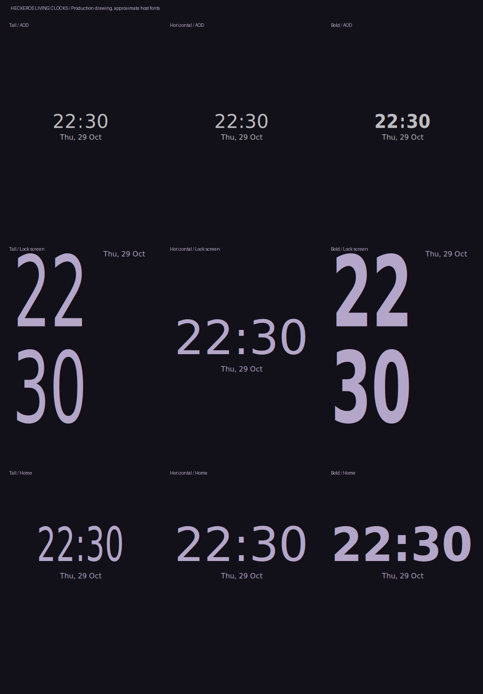
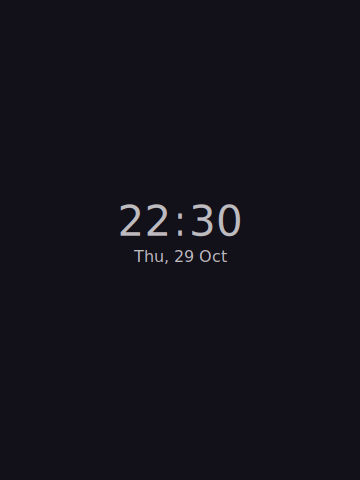

# Living Flow motion, clocks and Hecker QS

Implementation branch: `feat/living-flow-20261029`, based on `d9a1ca7`.
The matching Coral manifest retains the existing experimental low-brightness
protection, Caracal v2 depth layers, root-privacy, NetLab and Game Space work.

## References and implementation

Reviewed OPPO's [ColorOS 17 page](https://www.oppo.com/en/coloros17/) and
[Flow Everywhere explanation](https://www.oppo.com/en/newsroom/stories/oppo-color-os-17-smooth/)
on 29 October 2026. Also inspected the page's official 720p overview,
`videos-luminous-unlock-luminous-unlock-1.pc-2dfd96.mp4` and
`videos-luminous-unlock-luminous-unlock-2.pc-3f1cb3.mp4`.
The overview shows the two connectivity pills, media tile, paired vertical
sliders, round control grid, translucent surfaces and flexible button feedback.
The clock clip shows tall stacked digits changing into a horizontal Home clock.

These are original Android implementations of that visual direction, using
platform fonts and existing native controllers. No OPPO binaries, fonts or
marketing frames are shipped in the ROM.

## Clock and wallpaper

**Hecker Suite → Lock screen** adds Living Tall, Horizontal and Bold, five colours,
bounded size/position adjustments and **Match clock on Home**. Existing style IDs
and imported depth pairs are retained. The bundled tall style also uses the
continuous renderer; existing chosen clock settings are preserved.

The selected tall/living clock stays present across AOD and wake. The native
StatusBarStateController doze frames drive digit placement, size, colour,
wallpaper opacity and blur; reversal follows those same frames. AOD is monochrome,
has no wallpaper blur and retains the native burn-in-aware clock host. Word-clock
decoration remains off on AOD. The existing native small-clock host still handles
notifications and available space.

Background and subject retain one crop. A subject-alpha mask removes covered
clock pixels instead of painting a second subject over the clock. The wallpaper
uses a GPU blur only during the wake/sleep transition, with sharp clock artwork.
No photo decoding or CPU frosting runs on animation frames. Living Flow keeps
Home at the finished lock wallpaper crop, avoiding a second zoom jump on unlock.
The older Home zoom remains available when Living Flow is disabled.

Hecker Launcher's built-in clock uses the same renderer, colour and opacity with
a short authenticated Home arrival. Separately configured widgets keep their
existing style. Missing Home clock space still hides that header to protect apps.

The keyguard-to-Gone scene now has a longer, coordinated fade and gentler travel.
This is a matching cross-screen appearance and reveal, not an arbitrary-position
shared-element handoff between SystemUI and Launcher processes.





These host renders exercise production drawing commands. They are not phone
screenshots, and do not establish Android font parity or recorded frame pacing.

## Hecker QS

Select **Hecker QS** under **Hecker Suite → Quick Settings**.

- Two connectivity pills with the real native labels, state and detail actions.
- A live-session player beside paired vertical brightness/volume controls.
- Upright localized percentages remain on both controls at every value.
- Round tiles, subtle rim lighting, native state changes and spring press feedback.
- Every selected custom/native tile remains reachable in the paged editor order.
- Large fonts/narrow screens stack connectivity/media and reduce grid columns.

The existing enabled native notification-shade blur blurs the underlying scene.
The panel itself stays sharp; a neutral dark scrim maintains text contrast over
bright content. Native hardware, power and blur-availability gates retain their
opaque fallback. One UI QS keeps its layout and percentages. Native brightness
gamma, auto-brightness, restrictions, falsing and media-volume behavior remain.

## Other motion and controls

Native clipped folder previews, glass and icons now share one settling curve,
without the old extra preview delay. Shell's default fullscreen app/Home
transitions gain gentle scale, translation and independent alpha timing.
Native icon-origin clip/scale launches retain their geometry and child durations,
with the same settling curve. Custom app, cross-profile, voice, relaunch, dream, scene and non-fullscreen
transitions keep their native paths. Shell retains surface ownership, cancellation,
animation-scale and finish handling.

**Hecker Suite → Animations → Living Flow animations** is enabled by default.
Additional effects respect system animation disabling and Battery Saver. Native
shade/scene gesture ownership, accessibility, security and unlock timing remain.

Pixel Launcher is still the sole Recents/Quickstep provider. Its binary-owned
Recents/swipe-home/icon-to-window animations are not replaced by this change.
A complete ColorOS-style Recents implementation requires a source-owned Quickstep
provider and a separate tested migration; this branch does not claim that work.

## Validation and remaining acceptance

- Production clock geometry: 17,496 AOD/wake/Home, style, size, position and locale
  cases, including Urdu/Arabic numerals; exact settling endpoints and bounds.
- Production Shell helper: animation endpoints, monotonic frame curve, independent
  alpha timing, Home/fullscreen/type gates, Battery Saver and opt-out.
- Suite host regressions, SDK Java/resource/AIDL and SystemUI Compose compilation.
- Native Launcher helpers/resources and actual pinned source adapters; upgrades
  from d9a1ca7, repeated application and exact reversion.
- Matching manifest validation and integration tests.

Run the repository checks plus:

```bash
python3 tools/check_flow_windows.py
python3 tools/render_living_flow.py
python3 tools/check_quick_settings.py --sdk-cache generated/sdk
python3 tools/check_native_ports.py --sdk-cache generated/sdk
```

A complete Soong/ROM build and Coral phone tests remain required. Record AOD to
lock screen, sleep during wake, fast repeated unlock, notifications forcing a
small clock, Home arrival, app open/close, rapid folder reversal, both QS layouts,
sliders at 0/1/50/100%, large fonts, Battery Saver, animation scales, user switching
and low-brightness refresh behavior. This is implementation/source validation,
not a claim of identical proprietary behavior or guaranteed 90-fps performance.
