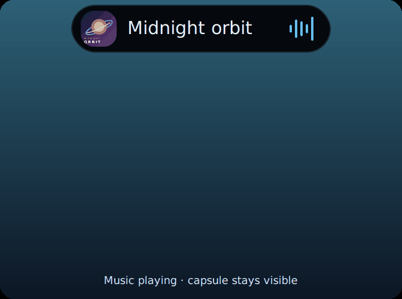

# Coral music Motion Island and astronaut

This feature lives on `test/coral-root-privacy-20261027`. The Suite's guarded
source adapters install native SystemUI views; the matching Motion Sense plugin
supplies a rebuilt Oslo APK with scoped gesture feedback. Coral's manifest pins
both. The root privacy and retained Suite Polish source baseline is preserved.

## Behavior

Open **Hecker Suite → Motion Sense → Motion Island & creature**, also available
under **Status bar**. Both switches default on for this test. Motion Island is
required for the astronaut; its separate switch turns only the character off.

The black status-bar capsule stays visible during music playback, independently
of the Oslo glow. It shows album art, a short title or recent gesture result,
and five thin, rounded cyan/blue vertical bars. Their playback-driven animation
matches the reference's visual style; it is decorative, not microphone/FFT data.
Tap the capsule to open **the same `HeckerMediaCard` composable used on the
lockscreen**, with artwork, titles, progress, seek, transport and output controls.
The expanded card is pinned to that session and can remain open while paused.
Outside tap, back, screen off, user change or session destruction dismisses it.

The astronaut follows the user's second reference, with a glossy black visor,
white outline and intact limbs. Its raised hand grips a thin rope from the
capsule. A flick swings it first in the **physical hand direction**, including
when the user's next/previous mapping is reversed. Play and pause wave the free
hand in a brief goodbye. Each gesture restarts a 2.4-second appearance with a
soft entrance, damped swing and 420 ms fade/retraction after inactivity. A pause
allows that farewell to finish before the capsule hides; ordinary pause hides
the capsule. The astronaut is hidden while the expanded player is open.

Screen off, AOD, disabled Motion Sense or disabled Island removes both views.
Battery saver and disabled system animations use still bars and an astronaut
pose; the gesture lifetime still expires and no decorative frame loop runs.
The clickable window is bounded to the 148×32 dp capsule; the separate 224×150 dp
astronaut window is non-touchable, so the rope/body cannot intercept app input.

## Music and user scope

The shared observer queries the current Android user's sessions and watches all
candidates, including paused sessions whose playback changes without a session
list update. It prefers playing music and cleans up callbacks on stop, removal,
user change and plugin teardown. The expanded player uses the tapped token,
including its paused state, rather than switching its controls to another app.
The existing lockscreen/QS default selection remains unrestricted.

Music classification uses the player's AudioAttributes: MUSIC is eligible;
MOVIE, SPEECH, sonification and non-media usages are excluded. Unknown content
needs a recognized music package or both album and artist metadata. YouTube's
main video app, Netflix and Prime Video are excluded; YouTube Music is separate.
Android exposes no universal song/video flag, so ambiguous third-party players
without music attributes or metadata can be omitted. Podcasts declaring SPEECH
are intentionally outside this music-only surface.

## Command boundary

The non-sticky v1 event is explicitly addressed to SystemUI. Both ends require
`android.permission.STATUS_BAR_SERVICE`. It is emitted only after an existing
play/pause/track/Air DJ command is dispatched; the feedback path adds no radar
subscription and sends no commands itself. Its new optional `direction` is
-1/0/+1 from raw Oslo directions, independent of action ID. Tap has direction 0.
Rejected, partial, training and failed commands do not animate the character.

The receiver checks current user, current-user music token, event age ≤1.2 s,
monotonic timestamp, valid action and a playing/just-playing session. The sender
captures the user before dispatch and rejects a switch during the command.
Action captions distinguish requests from reported play/pause/track changes;
volume is read from the controlled session, including remote sessions. Tokens
and bounded pre-command identities stay within the privileged package boundary.

## Validation

`tools/render_motion_island.py` executes the production capsule/astronaut drawing
code against recording Canvas declarations and renders it with Pillow/CairoSVG.
The sprite was created with a transparent-background imagegen reference edit;
`framework/motionisland/artwork.json` records its provenance. This is a host
design preview, not a phone screenshot.

Checks execute the real lifetime/choreography policy, session observer, current
user isolation, candidate playback/attribute changes, pinned paused transport,
callback cleanup and source controller. Kotlin/Compose and Java/resources are
compiled with locked SDK dependencies. Native ComposeInitializer/SystemUIDialog
signatures were reviewed at framework pin
`140b06a482a6ecbbdbe33190a149228c50220fb1`; the popup uses a direct content child
and a matching dialog WindowContext. Native source adapters apply idempotently
and revert exactly; Android 17's real manifest merger checks the Settings host.
The rebuilt APK has two DEX files, 5,994 classes and no duplicate definitions;
its manifest is unchanged. Full ROM/Soong compilation and Coral hardware testing
remain required.

Phone acceptance: music/video transitions; Spotify/YouTube Music/local/remote
players; tap/seek/output/back; reversed skip mapping; rapid left/right and
play/pause gestures; no-gesture fade; separate switches; lockscreen/HOME/apps;
AOD, screen off, user switch, battery saver and reduced motion; font size,
rotation/status-icon/face-feedback overlap; plugin reconnect and SystemUI restart.
