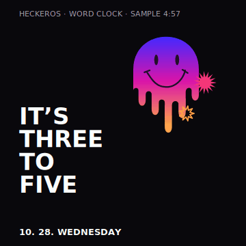
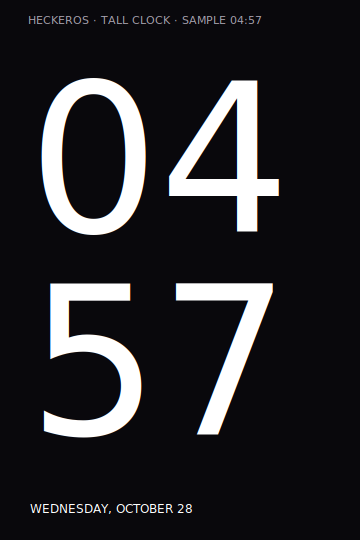

# Reference Settings and depth lockscreen — 28 October 2026

Experimental branch: `feat/settings-depth-lockscreen-20261028`, based on
`test/coral-root-privacy-20261027` including astronaut commit `040820a`.
The matching Coral local-manifest branch selects this source. Full Settings/SystemUI
Soong builds, on-phone appearance, wake transitions and hardware acceptance remain
required. This is not a tested ROM release.

## Settings homepage

The supplied phone photos define the black dark-mode background, charcoal grouped
cards, coloured circular icons, title-only rows, inset separators and floating bottom
Search pill. The HeckerOS hero and maintainer/Suite card remain. The header scrolls;
the Search pill remains above the native navigation inset. Voice search uses the
installed system speech dialog and opens the native Settings search with its result;
its microphone is hidden when no speech activity is available.

All 23 native categories keep their original keys, controllers, restrictions,
destinations and alert indicators. Existing Suite pages supply the new Themes,
Home screen, and Lock screen and AOD links. There are no cosmetic menu entries for
unimplemented Samsung services. Light mode uses the corresponding light surfaces.
Pixel-to-pixel font/spacing parity cannot be established from perspective photos;
compare a flashed build on Coral at default and large font scales.

## Lockscreen clocks

Open **Settings → Hecker Suite → Lock screen**. Enable the custom clock and choose:

| Style | Behavior |
| --- | --- |
| Geometric | Retains the existing geometric clock. |
| Word clock · English | Real minute wording, melting gradient smiley and two counter-rotating starbursts. For 4:57 it reads “IT’S THREE TO FIVE”. |
| Tall depth clock | Large, thin stacked hour/minute digits; collapses to a compact time when the native layout requests a small clock. |

The selection handles shown around the clock in the reference are editor controls,
so they are not painted permanently on the lockscreen. Artwork is original native
Canvas drawing, not extracted Samsung/ColorOS code or fonts. Both rotating decorations
pause when the lockscreen is hidden, the screen is off, on AOD, in Battery Saver,
or with animators disabled.
AOD retains the small existing geometric presentation and native burn-in handling.
The date/time, media, notifications, credential flow, unlock affordances and touch
handling remain native.

Host renders of the production Canvas commands, with approximate host font metrics:





## Depth wallpaper

Choose **Import depth wallpaper**, select the full background and a matching PNG
foreground with transparency around the subject, review the combined layers, then
Apply. Both layers must retain the same canvas/aspect and crop. An opaque foreground,
empty mask, mismatched dimensions or excessive image dimensions is rejected.
Applying selects and enables the tall clock and depth wallpaper.

This first implementation imports prepared layers. It does not automatically
extract a subject, inpaint the background or download an AI model. Automatic subject
extraction remains a separate feature requiring model/license, edge-quality and
on-device performance validation.

The native lockscreen scene draws the background, clock, and foreground in that
order. The foreground is projected into the clock's actual screen coordinates, so
it can cover digits without covering native notification or unlock controls. A
750 ms wake animation zooms the aligned image layers subtly while revealing the
clock behind the subject. Both image layers use the same crop throughout: a normal
photo already contains its subject, so shifting the cutout independently would
produce a second edge. Reduced motion skips the transition. No wallpaper or clock
layer installs a touch handler or creates an additional input window.

Imports are decoded/compressed off the UI thread, downscaled to a maximum 1,600-pixel
edge and copied into per-user app storage. The active pair is published only after
both files are complete. The read-only provider checks SystemUI's platform signature
and package, validates the active identity and never accepts arbitrary paths.
Unavailable assets, pre-first-unlock storage, disabled depth or an import failure
leave the native wallpaper available. Switching depth off restores the existing
native wallpaper; the importer does not replace the home wallpaper.

## Intermittent navigation freeze

The report predates flashing this new branch. Opening Settings from Quick Settings
and returning can refresh focus or launcher/Recents state, but does not establish
which component failed. This branch does not claim a navigation fix and does not
periodically restart SystemUI/launcher or toggle navigation mode.

With USB debugging connected, capture the broken state **before** using the
workaround, and then the recovered state:

```bash
bash vendor/hecker/floral/suite/tools/capture_navigation_state.sh frozen
# Open Settings from Quick Settings and return, as in the reported workaround.
bash vendor/hecker/floral/suite/tools/capture_navigation_state.sh recovered
```

Run from the computer's Android source root. Outside a source checkout, use the
path to this repository's helper. Add `--serial SERIAL` before the state if needed.
It only reads device diagnostics; it does not clear logs or restart anything.
The local output includes input dispatch/windows, focused activities, Recents,
SystemUI/services, navigation mode and recent logs. Note whether Back also fails,
or only Home/Recents, the foreground app, and the installed build fingerprint.
Logs are not uploaded automatically.

## Source validation

Validated in this change: 117 host tests, 81 integration tests, locked-SDK app/resource/AIDL
compilation, Settings homepage Java/resource compilation and SystemUI Compose compilation.
The prepared `040820a` adapters upgrade to this version, apply a second time without changes,
and revert exactly to the pinned native inputs. Full ROM/device testing is pending.

```bash
bash tests/run_host_tests.sh
python3 tools/compile_sdk.py --cache generated/sdk
python3 tools/check_settings_home.py --sdk-cache generated/sdk
python3 tools/check_quick_settings.py --sdk-cache generated/sdk
python3 tools/check_native_ports.py --offline
python3 -m unittest discover -s integration/tests -p 'test_*.py'
python3 tools/render_lockscreen_clocks.py
```

The first native-port run fetches immutable inputs; omit `--offline` then.
`check_settings_home.py` uses those pinned Settings inputs. The checks compile
the owned Java/Compose/resource adapters, exercise all 1,440 word-clock minutes,
2,400 crop/frame/aspect combinations and the production provider's caller/path/user
boundaries, and check source-adapter application, upgrades and exact reversion.
Host artwork previews require Pillow and CairoSVG. These are not full ROM,
phone navigation, TalkBack or screen-on performance tests.
